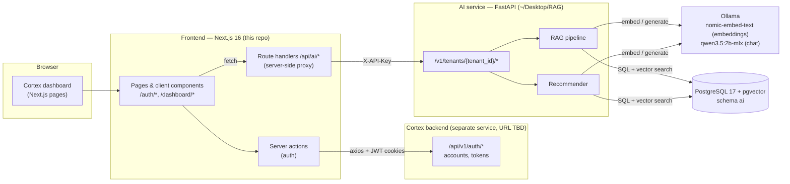
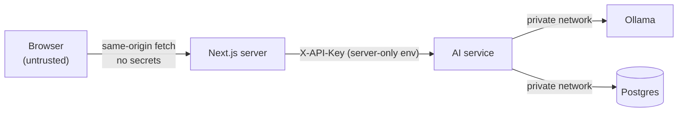
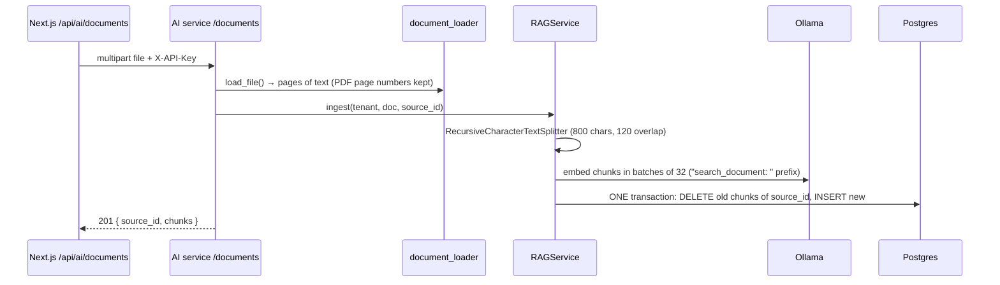
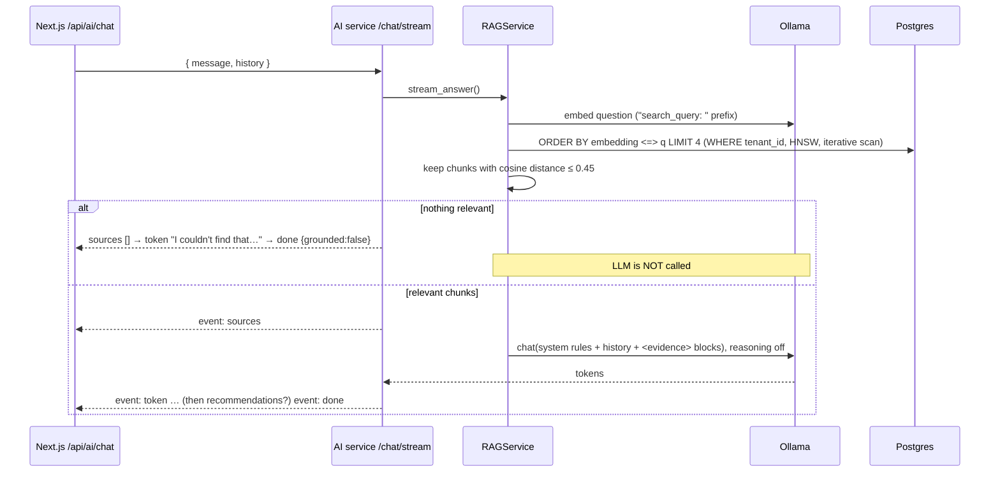
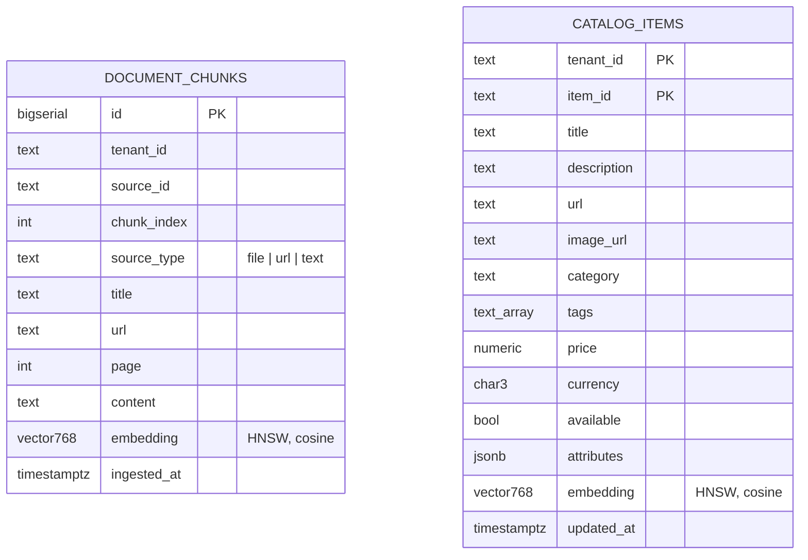

# Cortex — Architecture

How the parts of Cortex fit together, how requests flow between them, and why it's built this way.
For setup, features and project status, see [project-details.md](project-details.md).

## File structure

```
my-app/
├── public/brand/                     Cortex logo marks (light + dark)
├── src/
│   ├── auth.ts                       NextAuth config (Google sign-in)
│   ├── types/next-auth.d.ts          Session type extensions
│   └── app/
│       ├── layout.tsx                Root layout (fonts, metadata, ToastProvider)
│       ├── page.tsx                  Home (placeholder)
│       ├── globals.css
│       │
│       ├── auth/                     Auth pages
│       │   ├── error.tsx
│       │   ├── login/                layout.tsx, page.tsx
│       │   ├── register/             layout.tsx, page.tsx
│       │   ├── forgot-password/page.tsx
│       │   ├── reset-password/page.tsx
│       │   └── verify-email/page.tsx
│       │
│       ├── dashboard/                Dashboard pages
│       │   ├── layout.tsx            Sidebar shell
│       │   ├── page.tsx
│       │   ├── knowledge/page.tsx    Knowledge base (documents, URLs, text)
│       │   └── chat/page.tsx         Test chat with the assistant
│       │
│       ├── api/                      Route handlers (server-side proxies)
│       │   ├── ai/                   → AI service (adds API key + tenant)
│       │   │   ├── chat/route.ts                 POST, streams SSE
│       │   │   ├── documents/route.ts            POST multipart upload
│       │   │   ├── documents/text/route.ts       POST plain text
│       │   │   ├── sources/route.ts              GET list
│       │   │   ├── sources/[sourceId]/route.ts   DELETE
│       │   │   └── urls/route.ts                 POST website URL
│       │   └── auth/                 → Cortex backend /api/auth/* (passes status + body through)
│       │       ├── [...nextauth]/route.ts        NextAuth (Google OAuth)
│       │       ├── register/  login/  google-session/  refresh/  resend-verification/   POST
│       │       ├── verify-email/route.ts         GET ?token=
│       │       ├── me/route.ts                   GET, forwards Bearer token
│       │       └── logout/route.ts               POST, forwards Bearer token
│       │
│       ├── features/
│       │   ├── ai/
│       │   │   ├── api/aiApi.ts                  Browser client for /api/ai/* (+ SSE parser)
│       │   │   ├── server/aiServiceClient.ts     Server-only AI service client
│       │   │   ├── types/ai.types.ts
│       │   │   └── ui/                           KnowledgeBase, AddContentPanel, ChatPanel,
│       │   │                                     ChatMessage, DashboardNav
│       │   ├── auth/
│       │   │   ├── api/authApi.ts                Browser client for /api/auth/* (throws ApiError)
│       │   │   ├── server/backendClient.ts       Server-only backend client for /api/auth/* (relays cookies)
│       │   │   ├── signIn/  signUp/  resetPassword/  emailValidation/
│       │   │   │     each: hooks/  types/  ui/  utils/ (server action)  test/
│       │   │   ├── types/auth.types.ts
│       │   │   ├── ui/                           AuthComponents, AuthPanelEnter, GoogleSignInButton
│       │   │   └── utils/                        typeSchema (zod), submitHelpers, mockBackend
│       │   └── toast/                            useToast hook + ToastProvider
│       │
│       └── shared/
│           ├── hooks/useAuthForm.ts          (+ inline server field errors)
│           ├── hooks/useApiErrorHandler.ts   Global API error handler (toast / fields / sign-in)
│           ├── types.ts/main-response.ts
│           ├── types.ts/problem-details.ts   API error body (problem+json)
│           ├── ui/                   Button, Input, Spinner, ErrorPage, shake, shared-index
│           └── utils/
│               ├── API/              apiClient (fetch + 401 refresh), AxiosClient (old /api/v1 calls), axios-error
│               ├── AuthUtils/        CookieIntegration (token cookies), tokenUtils
│               ├── errors/           apiError (ApiError), errorResponse, safeMessage
│               ├── config.ts         Backend URLs from env
│               └── focusFirstInvalid.ts
│
├── next.config.ts                    Redirects for old auth URLs, Turbopack CSS
├── .env.local.example                Required environment variables
├── AGENTS.md  architecture.md  project-details.md  README.md
└── package.json  tsconfig.json  eslint.config.mjs
```

## 1. What Cortex does

Cortex is **RAG as a service for websites**. A business uploads its documents (policies, FAQs,
product info) and website pages; Cortex embeds an AI assistant on their site that:

- **answers visitors' policy questions** using only that business's content, with citations, and
- **recommends** relevant products or pages.

Each business is a **tenant**. Tenants never see each other's data.

## 2. System overview



| Component | Tech | Responsibility | Location |
|---|---|---|---|
| Frontend | Next.js 16.4 (App Router), React 19.3, Tailwind v4 | Auth screens, dashboard (knowledge base, chat), proxy to the AI service | `Cortex-Frontend/my-app` |
| Backend | Not in these repos yet | Accounts, sign-in/registration, tokens, tenant ↔ account mapping | URL via `NEXT_Backend_URL` |
| AI service | Python 3.13, FastAPI, LangChain | Ingest documents, answer questions (RAG), recommendations | `~/Desktop/RAG` |
| Models | Ollama (local) | `nomic-embed-text` → 768-dim vectors; `qwen3.5:2b-mlx` → answers | `localhost:11434` |
| Database | PostgreSQL 17 + pgvector 0.8 | Chunks, catalog items, HNSW vector indexes | `docker-compose.yaml` in the RAG repo |

## 3. Trust boundaries



- **The browser never talks to the AI service.** The API key lives only in the Next.js server
  environment (`CORTEX_AI_API_KEY`). `src/app/features/ai/server/aiServiceClient.ts` imports
  `server-only`, so the build fails if it's ever pulled into client code.
- **The AI service trusts only the API key**, compared in constant time. It should not be exposed
  to the public internet.
- **Tenant isolation is enforced in SQL.** Every query in `app/repositories/*` filters on
  `tenant_id`; ids are validated (`^[A-Za-z0-9_-]{1,64}$`) at the HTTP layer and again in services.
- **Customer-supplied URLs are SSRF-checked.** `web_loader.py` resolves the host and rejects
  private, loopback, link-local and reserved addresses, re-checking every redirect hop.
- **Retrieved content is data, not instructions.** The system prompt tells the model to ignore
  instructions inside documents, and evidence is wrapped in `<evidence>` tags.

## 4. Frontend (Next.js)

```
src/
  app/
    auth/                login, register, forgot-password, reset-password, verify-email
    dashboard/           layout (sidebar) + knowledge/ + chat/
    api/
      ai/                proxy route handlers → AI service
        sources/  sources/[sourceId]/  documents/  documents/text/  urls/  chat/
      auth/[...nextauth] Google OAuth (Auth.js)
    features/
      auth/              sign-in, sign-up, reset, email validation (hooks, actions, UI)
      ai/
        server/aiServiceClient.ts   server-only client (adds API key + tenant)
        api/aiApi.ts                browser client for /api/ai/* (+ SSE parser)
        ui/                         KnowledgeBase, AddContentPanel, ChatPanel, ChatMessage, DashboardNav
        types/ai.types.ts           shapes returned by the AI service
    shared/              Input, Button, Spinner, hooks, Axios client, utils
  auth.ts                Auth.js (Google) config
```

Key patterns:

- **Backend-for-frontend proxy.** `/api/ai/*` route handlers validate input, attach
  `X-API-Key` + tenant id, forward to the AI service, and pass status + JSON through. If the AI
  service is unreachable they return `503`. Route handlers are used instead of server actions
  because uploads exceed the 1 MB server-action limit and chat needs streaming.
- **Streaming chat.** `/api/ai/chat` pipes the AI service's Server-Sent Events body straight to
  the browser. `aiApi.streamChat()` parses events (`sources` → `token`… → `recommendations` →
  `done` | `error`). Cancelling the request aborts generation upstream.
- **Auth forms** use server actions that call the backend through Axios. Until
  `NEXT_Backend_URL` is set they run in **demo mode**: a 2-second delay, then a demo success
  (`features/auth/utils/mockBackend.ts`).
- **Validation** uses zod schemas (`features/auth/utils/typeSchema.ts`). Password rules (8+
  characters, 1 uppercase, 1 symbol) are defined once and shared by the schema and the live
  checklist.

## 5. AI service (FastAPI)

Layered so each file has one job. Requests flow **route → service → repository → Postgres**.

```
app/
  main.py                  lifespan: open DB + create tables, build models & services; include routers
  core/                    config (CORTEX_AI_* env), database (pool + DDL), security (API key), ids, errors
  schemas/                 Pydantic request/response models per feature
  api/routes/              health, knowledge, chat, recommendations, tenants
  services/                ai_models, document_loader, web_loader, prompts, rag_own_version, recommender
  repositories/            document_chunks.py, catalog_items.py — all SQL lives here
```

### 5.1 Ingestion



- All embeddings are computed **before** the transaction, so a failure part-way (e.g. Ollama
  down) leaves the previous version intact. Re-sending the same `source_id` replaces it.
- Default ids: `file:<filename>`, `url:<hash>`, `text:<hash>`. The backend can pass its own.

### 5.2 Answering (RAG)



Two guardrails:
1. **Relevance cutoff** (`CORTEX_AI_MAX_COSINE_DISTANCE=0.45`): off-topic questions never reach
   the LLM. The value was calibrated on real data: on-topic chunks scored 0.78 to 0.86 similarity,
   off-topic about 0.47.
2. **Scoped prompt** (`services/prompts.py`): business topics only, evidence-only facts, cite
   `[n]`, ignore instructions inside evidence, at most 3 sentences.

### 5.3 Recommendations

Content-based, so it works without any click history:

- The catalog (products, pages, plans) is pushed by the backend → each item's
  title/category/tags/description is embedded → `ai.catalog_items`.
- The target vector is the query embedding, the mean of viewed-item embeddings, or a blend
  (60% query, 40% viewed).
- One SQL query does nearest neighbours **plus** filters: category, `tags && …`, `available`,
  exclusions (viewed items are never recommended back).
- Results below `CORTEX_AI_MIN_RECOMMENDATION_SCORE` are dropped.

## 6. Data model (schema `ai`)



- Unique `(tenant_id, source_id, chunk_index)`; indexes on `(tenant_id, source_id)` and
  `(tenant_id, category)`.
- Tables are created idempotently at AI-service startup (no separate migration tool yet).
- The service refuses to start if the table's vector size doesn't match the embedding model.
- The schema is separate from the backend's tables, so both can share one Postgres database.

## 7. API surface

### Frontend → AI service (via `/api/ai/*`)

| Browser calls | Forwards to (AI service, under `/v1/tenants/{tenant}`) |
|---|---|
| `GET /api/ai/sources` | `GET /sources` |
| `DELETE /api/ai/sources/{id}` | `DELETE /sources/{id}` |
| `POST /api/ai/documents` (multipart) | `POST /documents` |
| `POST /api/ai/documents/text` | `POST /documents/text` |
| `POST /api/ai/urls` | `POST /sources/url` |
| `POST /api/ai/chat` (SSE) | `POST /chat/stream` |

The AI service also exposes `/chat` (non-streaming), `PUT /catalog/items`,
`POST /catalog/items/delete`, `POST /recommendations`, `DELETE /v1/tenants/{tenant}`, `/health`
and `/health/ready`. Interactive docs are at `http://localhost:8000/docs`.

### Frontend → Backend (auth, via server actions)

`/api/v1/auth/login`, `/register`, `/send-password-reset-token`, `/resend-verification-email`,
`/reset-password`, `/refresh`, `/api/v1/admin/login`.

## 8. Error handling

| Situation | AI service | Frontend shows |
|---|---|---|
| Missing/wrong API key | 401 | "The AI service rejected our API key…" |
| Bad input / unsupported file / private URL | 422 | The service's message, inline |
| Upload too large | 413 | "File is larger than 20 MB" |
| Ollama down / model missing | 503 | "The AI service is unavailable right now…" |
| AI service unreachable | — | 503 from the proxy, with retry UI |
| Failure mid-stream | `event: error` | Error inside the assistant bubble |

## 9. Key decisions

| Decision | Why |
|---|---|
| pgvector instead of Chroma | One database for the whole platform, SQL filters for tenant/category/tags, transactions for atomic re-indexing. |
| Separate Python AI service | The ML/LLM ecosystem is Python; it scales independently of the web app. |
| Next.js route handlers as a proxy | Keeps the API key server-side; supports large uploads and streaming. |
| Local Ollama models | No per-token cost and data stays on-prem during development. Swappable in `services/ai_models.py`. |
| Relevance cutoff before the LLM | Cheaper, faster, and stops made-up answers to off-topic questions. |
| Content-based recommender | Useful from day one; collaborative signals can be blended in later. |
| Per-tenant filtering, not per-tenant tables | Simple operations at many tenants; HNSW iterative scans keep small tenants' results complete. |

## 10. Known gaps

- **No auth on the dashboard or `/api/ai/*`** yet. Anyone who can reach the app can read, upload
  or delete knowledge-base content.
- **One fixed tenant** (`CORTEX_AI_TENANT_ID=demo`) until the backend exposes the signed-in
  account's site id.
- **Synchronous ingestion**: a large PDF can take tens of seconds per request. Move it to a
  background job with status polling.
- **No embeddable visitor widget yet.** The dashboard chat is the test surface.
- **Port 5432 conflict locally**: Homebrew Postgres 15 (no pgvector) takes `localhost:5432`
  before the Docker container can.
- **Recommendation threshold** (0.35) is too low for real embeddings; calibrate it with real
  catalog data.
- **No automated tests** at the moment (removed on request during the AI-service restructure).
